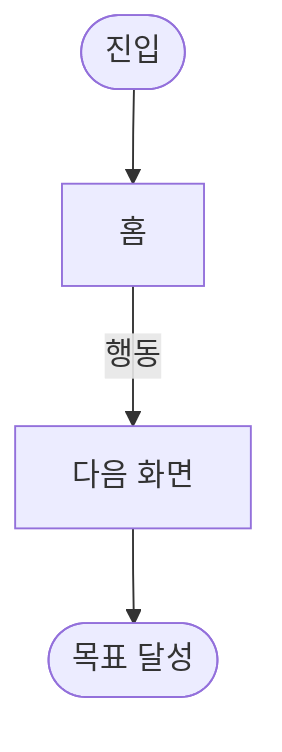

# {{PROJECT}} — UX 플로우

{{NAV}}

작성일: {{DATE}}

<!-- wf:flow
status: draft
-->

> 근거: [기능 명세](02-spec.md). 완료 조건: 모든 Must 기능이 플로우에 등장하고 사용자가 확인함 → `status: done`

## 한눈에

- 

## 화면 목록

4단계 와이어프레임 파일명이 됨. slug 는 영소문자·숫자·`-`.

| slug | 화면명 | 관련 기능 |
| --- | --- | --- |
| home | | [F-01](02-spec.md#f-01) |

## 전체 플로우

## 핵심 과업별 경로

| 기능 | 시작 화면 | 경로 | 이탈·예외 분기 |
| --- | --- | --- | --- |
| [F-01](02-spec.md#f-01) | [home](04-wireframe/home.html) | home → … | |
