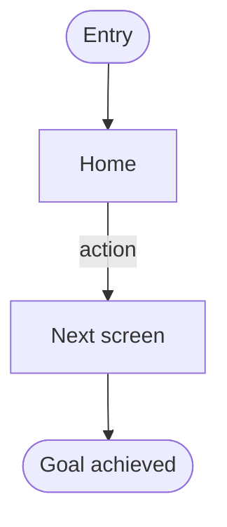

# {{PROJECT}} — UX flow

{{NAV}}

Created: {{DATE}}

<!-- wf:flow
status: draft
-->

> Basis: [feature spec](02-spec.md). Done when: every Must feature appears in the flow and the user has confirmed → `status: done`

## At a glance

- 

## Screen list

These become the stage 4 wireframe file names. A slug is lowercase letters, digits, and `-`.

| slug | Screen name | Related feature |
| --- | --- | --- |
| home | | [F-01](02-spec.md#f-01) |

## Overall flow

## Core task paths

| Feature | Start screen | Path | Exit/exception branches |
| --- | --- | --- | --- |
| [F-01](02-spec.md#f-01) | [home](04-wireframe/home.html) | home → … | |
